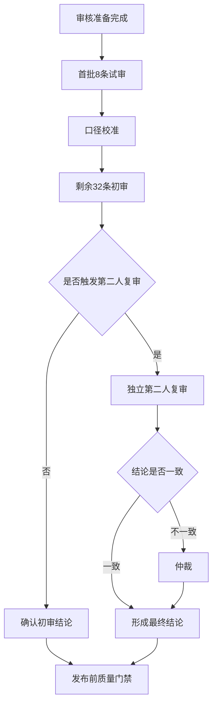

# FinGoose 事件型宏观数据集人工审核手册 v1

## 1. 目的与边界

本手册用于审核“重大事件 -> 金融市场波动 -> 传导机制 -> 竞争解释 -> 短期预测”样本。

本数据集采用证据加权的事后归因，不宣称严格计量因果。人工审核的目标是判断现有证据是否足以支撑归因标签和短期预测，而不是寻找唯一原因。

审核人员不得查看 `hidden_forecast_outcomes.jsonl`。D20 隐藏结果只用于隔离的预测评测，不得反向影响事件归因和预测判断。

## 2. 审核流程



## 3. 角色与独立性

| 角色 | 职责 | 约束 |
|---|---|---|
| 初审人 | 审核全部40条样本 | 必须填写逐维判断和审核意见 |
| 复审人 | 审核15条自动触发样本 | 不得与该样本初审人为同一人；复审前不看初审结论 |
| 仲裁人 | 处理初审与复审分歧 | 必须记录接受或否决各方证据的理由 |
| 发布负责人 | 执行门禁、重建和版本冻结 | 不得代替未完成的人工审核 |

## 4. 固定推理链

每条样本必须按照下列顺序检查：

```text
MACRO_REPORT
-> DATA
-> PERIOD_DESCRIPTION
-> FACT_TRANSMISSION_CHAIN
-> MULTI_DATA_TREND_CONFIRMATION
-> SHORT_TERM_PREDICTION
```

推理链含义：

1. `MACRO_REPORT`：事件前或预测时点前可见的宏观报告。
2. `DATA`：事件期的可复算市场数据。
3. `PERIOD_DESCRIPTION`：明确观察期间及首次可交易时点。
4. `FACT_TRANSMISSION_CHAIN`：事件、机制和市场反应之间的事实链。
5. `MULTI_DATA_TREND_CONFIRMATION`：多个市场变量支持或反驳该链。
6. `SHORT_TERM_PREDICTION`：给出目标、方向、期限、置信度及失效条件。

## 5. 十项审核清单

每条任务均需完成以下检查：

1. 核对事件事实、发生时间和首次公开时间。
2. 核对基线是否为首次可交易时点前最后有效收盘。
3. 从归档行情复算预测时点可见的 D1 和 D3；不得查看 D5、D20 或 M3 结果。
4. 判断事件与波动时点是否吻合。
5. 判断波动是否显著偏离事件前60个交易日基准。
6. 判断传导机制是否明确、连续且方向一致。
7. 检查同期政策、经济数据和其他重大事件等竞争解释。
8. 判断多个市场变量是共同支持、混合还是反驳传导链。
9. 判断短期预测的目标、方向、期限和置信度是否合理。
10. 确认预测失效条件具体、可观察、可判定。

## 6. 四个核心维度

| 维度 | 支持 | 矛盾 | 未知 |
|---|---|---|---|
| 时点吻合 | 波动紧随首次可交易时点出现 | 波动早已发生或明显滞后 | 时间证据不足 |
| 异常程度 | 波动显著偏离60日基准 | 波动普通或方向相反 | 波动基准不可用 |
| 传导机制 | 事件、机制和市场方向连贯 | 中间机制或方向断裂 | 缺少关键机制证据 |
| 竞争解释 | 其他解释有限 | 存在更直接、更强解释 | 无法比较解释强弱 |

竞争解释维度在记录中使用 `LIMITED`、`MIXED`、`STRONG`、`UNKNOWN`。

## 7. 标签与置信度

| 标签 | 使用条件 |
|---|---|
| `PRIMARY_DRIVER` | 时点和异常程度显著，传导链完整，没有更强竞争解释 |
| `CONTRIBUTING_FACTOR` | 事件解释部分波动，但同时存在其他重要因素 |
| `WEAK_RELATION` | 只有有限时点或机制证据，多资产信号不稳定 |
| `UNSUPPORTED` | 时点、方向或传导机制不支持归因 |

| 置信度 | 使用条件 |
|---|---|
| `HIGH` | 四个核心维度一致，来源充分，竞争解释有限 |
| `MEDIUM` | 基本成立，但存在缺失信息或混合竞争解释 |
| `LOW` | 证据冲突、核心维度未知或存在强竞争解释 |

以下任一情况自动触发第二人复审：

- `LOW_CONFIDENCE`
- `STRONG_COMPETING_EXPLANATION`
- `CORE_DIMENSION_UNKNOWN`
- `CORE_DIMENSION_CONTRADICTED`

## 8. 批次安排

| 批次 | 事件 | 样本数 | 目的 |
|---|---|---:|---|
| `review-batch-01-pilot` | event-01 至 event-02 | 8 | 试审与口径校准 |
| `review-batch-02` | event-03 至 event-05 | 12 | 第一轮批量初审 |
| `review-batch-03` | event-06 至 event-08 | 12 | 第二轮批量初审 |
| `review-batch-04` | event-09 至 event-10 | 8 | 复杂及近期事件审核 |

首批8条完成后，应先比较不同审核人的维度判断和标签使用方式。口径未统一前，不进入剩余32条。

## 9. 审核意见最低要求

审核意见至少说明：

- 支持或反驳时点吻合的证据；
- 异常分数和关键窗口；
- 接受的传导机制；
- 最强竞争解释及其相对解释力；
- 最终标签和置信度理由；
- 短期预测失效条件是否充分；
- 若发生仲裁，说明最终采用哪一方证据及理由。

`PENDING` 记录不得填写虚构审核人或改为 `APPROVED`。只有实际完成审核后才能回填。

## 10. 审核决定提交

1. 初审人先读取 `review_work_queue.jsonl`，并打开对应批次的审核材料；首批试审使用 `pilot_review_packet.jsonl`。
2. 从 `review_decision_template.jsonl` 复制对应任务行，完整填写初审、必要复审和必要仲裁 verdict 后，将该行写入 `configs/fingoose_macro_review_decisions_v1.jsonl`。允许按批次增量提交，尚未提交的样本继续保持 `PENDING`。
3. 第二审核人只能使用 `second_review_packet.jsonl` 中的盲化材料，不得查看初审人的身份、意见、标签或置信度。复审人与初审人必须不同。
4. 初审人、复审人和仲裁人均不得打开 `hidden_forecast_outcomes.jsonl` 或 `hidden_attribution_labels.jsonl`，避免 D20 结果或当前归因标签反向影响人工判断。
5. 重新运行构建器后，格式、Schema、重复 ID、未知 ID、事件错配、独立性或仲裁错误都会写入 `audit_rejections.jsonl`；审核人应使用其中的 `line_number` 定位并修正输入行。无效决定不会覆盖原审核记录。

提交并重建：

```powershell
python build_fingoose_macro_event_attribution_v1.py `
  --config configs/fingoose_macro_events_v1.json `
  --review-decisions configs/fingoose_macro_review_decisions_v1.jsonl `
  --output-root outputs/fingoose_macro_event_attribution_v1
```

## 11. 发布门禁

正式发布前必须同时满足：

- 40条样本全部完成初审；
- 15条触发样本全部完成独立复审；
- 所有分歧完成仲裁；
- 不存在待审核状态；
- 所有数值可从归档序列复算；
- 所有来源快照、哈希和定位信息有效；
- `WEAK_RELATION + UNSUPPORTED >= 20%`；
- 任一标签占比不超过60%；
- 公开投影不含隐藏标签或D20隐藏结果；
- 全部自动测试通过；
- `summary.json` 中 `formal_ready=true`。

