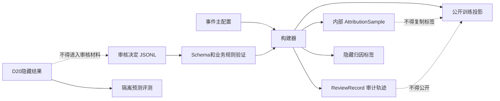

# FinGoose 事件型宏观审核决定导入设计

## 1. 背景

事件型宏观数据集已经生成10个事件、40条归因样本、40条审核任务和首批8条试审材料。当前生产审核记录全部保持 `PENDING`，发布门禁仅剩初审和复审未完成。

下一阶段需要提供独立、可增量、可审计的人工审核回填入口，并确保审核结论不会通过公开训练投影泄漏。

## 2. 目标

- 使用独立的 `configs/fingoose_macro_review_decisions_v1.jsonl` 保存人工审核决定。
- 允许审核结果按批次增量导入，未提交记录继续保持待审核。
- 自动验证审核身份、审核时间、审核意见、标签、置信度和四个核心维度。
- 根据初审结论自动判断是否需要独立第二人复审。
- 初审和复审存在分歧时强制要求第三人仲裁。
- 将最终人工结论同步到内部归因样本、隐藏标签和发布门禁。
- 从公开训练投影中移除归因标签、置信度、审核身份和审核意见。
- 继续保持旧版 `outputs/fingoose_formal_v1_macro` 不变。

## 3. 非目标

- 不代替人工审核，不自动生成 `APPROVED` 记录。
- 不为用户分配真实审核人员。
- 不提供浏览器审核界面或数据库服务。
- 不引入严格计量因果或回归估计。
- 不把D20隐藏结果暴露给初审、复审或仲裁人员。

## 4. 文件与接口

新增文件：

- `schemas/fingoose_macro_review_decision_v1.schema.json`
- `configs/fingoose_macro_review_decisions_v1.jsonl`
- `outputs/fingoose_macro_event_attribution_v1/review_decision_template.jsonl`
- `outputs/fingoose_macro_event_attribution_v1/second_review_packet.jsonl`
- `outputs/fingoose_macro_event_attribution_v1/hidden_attribution_labels.jsonl`

修改文件：

- `fingoose_macro_event_attribution_v1.py`
- `build_fingoose_macro_event_attribution_v1.py`
- `schemas/fingoose_macro_review_record_v1.schema.json`
- `tests/test_fingoose_macro_review_workflow_v1.py`
- `docs/fingoose_macro_event_review_handbook_v1.md`

命令行接口增加可选参数：

```powershell
python build_fingoose_macro_event_attribution_v1.py `
  --config configs/fingoose_macro_events_v1.json `
  --review-decisions configs/fingoose_macro_review_decisions_v1.jsonl `
  --output-root outputs/fingoose_macro_event_attribution_v1
```

CLI默认审核决定路径为 `configs/fingoose_macro_review_decisions_v1.jsonl`。该文件首版为空，因此默认构建仍保持全部记录待审核。

## 5. 审核决定 Schema

每行表示一条样本的完整审核轨迹：

```json
{
  "review_id": "review-event-01-single-sp500",
  "event_id": "event-01",
  "initial_review": {
    "reviewer_id": "reviewer-a",
    "reviewed_at": "2026-07-27T10:00:00+08:00",
    "comments": "时点、异常程度和传导机制均支持该归因。",
    "label": "PRIMARY_DRIVER",
    "confidence": "HIGH",
    "core_dimensions": {
      "temporal_alignment": "SUPPORTED",
      "abnormal_movement": "SUPPORTED",
      "transmission_mechanism": "SUPPORTED",
      "competing_explanations": "LIMITED"
    }
  },
  "second_review": null,
  "adjudication": null
}
```

`initial_review` 必填。`second_review` 和 `adjudication` 使用相同的 verdict 结构或为 `null`。

每个 verdict 必须包含：

- 非占位的 `reviewer_id`；
- 带时区且不晚于构建时点的 `reviewed_at`；
- 非空 `comments`；
- 固定枚举中的 `label` 和 `confidence`；
- 四个完整核心维度。

## 6. 复审和仲裁规则

复审触发原因从初审 verdict 重新计算：

- 置信度为 `LOW`；
- 竞争解释为 `STRONG`；
- 任一核心维度为 `UNKNOWN`；
- 任一核心维度为 `CONTRADICTED`。

触发复审时：

- `second_review` 必须存在；
- 复审人与初审人必须不同；
- 复审 verdict 必须独立完整填写。

初审和复审的标签、置信度或任一核心维度不完全一致时，视为存在分歧：

- `adjudication` 必须存在；
- 仲裁人必须同时不同于初审人和复审人；
- 最终结论采用仲裁 verdict。

若初审和复审完全一致，最终结论采用该一致 verdict，禁止添加不必要的仲裁记录。未触发复审时，最终结论直接采用初审 verdict。

## 7. 导入与错误处理

构建器按 `review_id` 关联审核决定和现有审核任务：

1. 读取审核决定 JSONL，保留行号。
2. 拒绝格式错误、Schema错误、重复或未知 `review_id`。
3. 拒绝 `event_id` 与原任务不一致的记录。
4. 对有效记录计算复审和仲裁要求。
5. 只应用完全有效的单条决定；其他样本继续保持 `PENDING`。
6. 将所有拒绝写入 `audit_rejections.jsonl`，包含审核ID、错误码和输入行号。

允许增量导入，但任何审核决定错误都会阻塞 `formal_ready`，不得静默跳过。

审核错误码至少包括：

- `REVIEW_DECISION_SCHEMA_INVALID`
- `REVIEW_DECISION_DUPLICATE`
- `REVIEW_DECISION_UNKNOWN`
- `REVIEW_EVENT_MISMATCH`
- `INITIAL_REVIEWER_PLACEHOLDER`
- `SECOND_REVIEW_REQUIRED`
- `SECOND_REVIEWER_NOT_INDEPENDENT`
- `ADJUDICATION_REQUIRED`
- `ADJUDICATOR_NOT_INDEPENDENT`
- `UNNECESSARY_ADJUDICATION`

## 8. 数据流与可见性



内部 `attribution_samples.jsonl` 保留最终标签、置信度、渠道和竞争解释。

`hidden_attribution_labels.jsonl` 必须始终保存40条，并包含 `record_id`、`review_id`、当前标签、当前置信度、当前核心维度和 `label_status`。尚未完成所需人工审核时，`label_status=PROVISIONAL`；初审、必要复审和必要仲裁全部完成后，`label_status=FINAL`。只有40条全部为 `FINAL` 才能正式发布。

公开 `training_projection.jsonl` 必须移除：

- `attribution`；
- `review_id`；
- `initial_review`、`second_review` 和 `adjudication`；
- `final_label`、`confidence` 和 `core_dimensions`；
- D20实际方向及其他隐藏结果。

## 9. 审核材料

`review_decision_template.jsonl` 为40条空白模板，包含任务ID、事件ID和待填写的三段审核结构，但不包含D20结果。

`second_review_packet.jsonl` 仅包含15条当前自动触发复审的样本材料，并移除：

- 初审人身份和审核意见；
- 初审最终标签和置信度；
- 配置中的建议标签和建议置信度；
- 所有隐藏结果。

复审包可以保留事件档案、可见来源、行情窗口、传导链和竞争解释事实，以支持独立判断。

## 10. ReviewRecord 演进

`ReviewRecord` 继续保存顶层最终标签、置信度和核心维度，并新增可选审计字段：

- `initial_review`：完成状态、审核人、时间和意见；
- `second_review`：完成状态、审核人、时间和意见；
- `adjudication`：完成状态、仲裁人、时间和意见；
- `second_review_trigger_reasons`：由初审结论计算。

公开投影不得包含这些字段。

## 11. 发布门禁

`formal_ready=true` 仍需满足原有事件、样本、来源、数值复算和标签分布门禁，并新增：

- 审核决定文件无解析或验证错误；
- 40条初审全部完成；
- 所有触发记录完成独立复审；
- 所有分歧完成独立仲裁；
- 40条隐藏归因标签完整生成且全部标记为 `FINAL`；
- 公开投影通过隐藏标签和审核信息扫描；
- 任何单一标签不超过60%；
- `WEAK_RELATION + UNSUPPORTED` 不少于20%。

## 12. 测试策略

单元测试覆盖：

- 空决定文件保持40条待初审；
- 有效初审决定可以增量应用；
- 初审低置信度或核心维度矛盾触发复审；
- 同一人复审被拒绝；
- 初审和复审分歧时强制仲裁；
- 仲裁人与前两人重复时被拒绝；
- 重复、未知和事件不匹配的审核决定被拒绝；
- 不必要的仲裁被拒绝。

集成测试覆盖：

- 40条完整一致审核可解除人工审核门禁；
- 最终标签分布从人工决定重新计算；
- 公开投影不含归因标签、审核身份、审核意见和D20结果；
- 隐藏归因标签恰好40条，默认构建为 `PROVISIONAL`，完整审核后为 `FINAL`；
- 15条独立复审材料不含初审结论；
- 旧版正式宏观输出不发生写入。

## 13. 验收标准

- 默认构建仍显示40条初审、15条复审待完成。
- 审核人员可只提交一个批次并得到明确的剩余工作统计。
- 无效决定不会覆盖原审核记录。
- 完整有效决定可以使人工审核门禁归零。
- 公开投影不含任何最终归因标签或审核轨迹。
- 全部自动测试通过后才进入实际8条试审。
