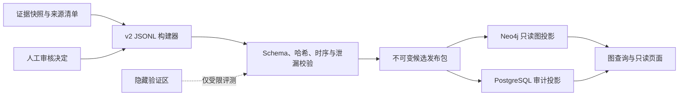
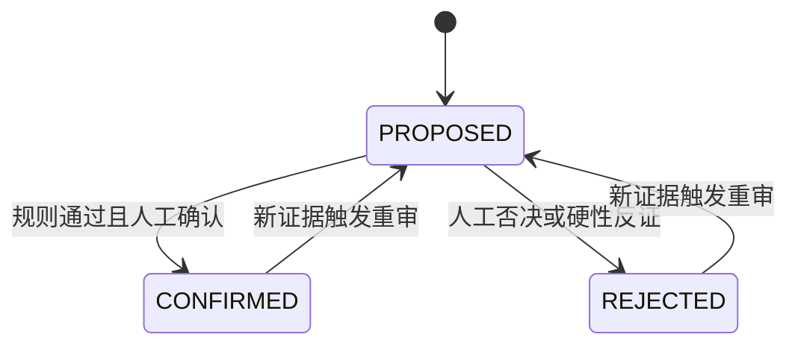

# FinGoose v2 节点级动态传导图与 Data-CI 架构交接设计

## 1. 状态与边界

- 设计状态：`APPROVED_FOR_MAIN_TASK_PLANNING`
- 实现状态：`FUTURE_INFRASTRUCTURE_DESIGN / NOT_IMPLEMENTED`
- 适用版本：`fingoose-macro-event-attribution-v2.0 CANDIDATE`
- 范围：10 个事件、事件里程碑、动态传导链、市场窗口、30 家公司候选及证据与审核信息
- 审计事实源：v2 JSONL、JSON Schema、证据快照和 `manifest.json`

本文供主任务直接制定实施计划。v1 与当前 v2 产物保持不变；Neo4j、PostgreSQL 和 Data-CI 尚未实施，不得描述为已经上线。

## 2. 核心修正

原草案的 `MacroEvent -> Company -> KPI` 不能表达事件内部节点、动态分支、反证和审核，应调整为：

```text
Event -> Milestone -> Episode
Milestone -> TransmissionHypothesis -> Channel -> IntermediateVariable
IntermediateVariable -> Asset
IntermediateVariable -> CompanyExposure -> Company
CompanyExposure -> KPI -> KPIObservation
```

`Evidence`、`MarketWindow`、`Confounder`、`Review` 独立建模并连接对应对象。

关键决定：

1. `Event` 与 `Milestone` 分开。事件是研究对象，里程碑是可排序、可引用的事实节点。
2. 一个里程碑可以启动、增强、削弱、反转或终止不同传导分支。
3. 传导命题实体化为 `TransmissionHypothesis`，用于连接证据、反证、条件、失效条件和审核。
4. 行情支持与经营支持分开；股价方向不能反向证明公司经营受益。
5. `CompanyExposure` 表示公司在特定事件节点下的业务暴露，不用一条 `Event -> Company` 静态边代替。
6. KPI 定义与观测值分开。SCFI、油价、收益率、汇率和指数属于市场或行业序列，不是单家公司 KPI。
7. 状态统一为 `PROPOSED / CONFIRMED / REJECTED`。AI 只能生成 `PROPOSED`。
8. JSONL 是不可变事实源；数据库只是可重建的查询投影，不能反向覆盖 JSONL。

## 3. 目标与非目标

目标：

- 回答“哪个节点通过什么渠道影响哪家公司，以及该影响是否被行情和经营数据分别支持”。
- 支持十事件高颗粒度时间线、节点级动态传导、多跳归因和跨事件公司暴露查询。
- 保留发生时间、首次公开时间、可见性、证据哈希、反证、混杂和人工审核轨迹。
- 以自动化校验保证 Schema、图投影、行情复算和隐藏数据隔离一致。

非目标：

- 不修改 v1，不自动继承 v1 的 `formal_ready=true`。
- 不把图数据库设为唯一事实源。
- 不自动确认模型生成的传导链。
- 不为突发事件制造共识值，不补造日期、哈希、比例、业务暴露或 KPI 数值。
- 不把隐藏标签、D3 后验证数据或审核隐私同步到公开投影。
- 不在本阶段实现实时交易或严格计量因果识别。

## 4. 事实源与投影

权威输入：

- `event_milestones.jsonl`
- `event_episodes.jsonl`
- `transmission_graphs.jsonl`
- `market_windows.jsonl`
- `benchmark_cases.jsonl`
- `hidden/benchmark_labels.jsonl`
- `source_manifest.jsonl`
- 证据快照目录
- `manifest.json`

派生投影：

- Neo4j：路径、分支、跨事件暴露和多跳查询。
- PostgreSQL：批次、审计、状态历史、复算、差异和发布记录。
- UI/RAG：只读取指定批次的公开投影；受限审核使用独立权限。

每条投影记录至少保存 `dataset_version`、`release_tier`、`projection_run_id`、`source_manifest_sha256`、`source_record_id`、`source_record_sha256`、`visibility`、`valid_from` 和 `valid_to`。



## 5. 规范图模型

| 节点 | 主键 | 含义与关键字段 |
| --- | --- | --- |
| `Event` | `event_id` | 十个事件主体、事件类型、预期类型 |
| `Milestone` | `milestone_id` | 发生时间、首次公开时间、阶段、事实、可见性、主次锚点 |
| `Episode` | `episode_id` | 前置背景、首次冲击、升级、政策响应、缓和、二次冲击 |
| `TransmissionHypothesis` | `hypothesis_id` | 状态、置信度、方向路径、时滞、条件和失效条件 |
| `Channel` | `channel_id` | 需求、成本、融资、流动性、风险溢价、汇率、供应链、政策等 |
| `IntermediateVariable` | `variable_id` | 事件专属中间变量、定义、方向和适用期间 |
| `Asset` | `asset_id` | 市场/行业序列或交易资产、角色、频率、时区、日历 |
| `Company` | `company_id` | 公司名称、证券代码、交易所和行业 |
| `CompanyExposure` | `exposure_id` | 特定事件路径下的业务分部、地域、收入、成本或融资暴露 |
| `KPI` | `kpi_id` | 指标名称、口径、单位和方向含义 |
| `KPIObservation` | `observation_id` | 期间、值、单位、同比/环比口径、来源和可见性 |
| `Evidence` | `evidence_id` | 发布者、层级、URL/PURL、定位、哈希和发布时间 |
| `MarketWindow` | `window_id` | T0、窗口日期和值、变化、计算依据和混杂等级 |
| `Confounder` | `confounder_id` | 重叠事件、影响范围、等级、来源和处理决定 |
| `Review` | `review_id` | 审核人、时间、决定、意见和独立性 |

核心关系：

```text
(Event)-[:HAS_MILESTONE]->(Milestone)
(Milestone)-[:IN_EPISODE]->(Episode)
(Milestone)-[:ANCHORS]->(TransmissionHypothesis)
(TransmissionHypothesis)-[:USES_CHANNEL]->(Channel)
(TransmissionHypothesis)-[:AFFECTS_VARIABLE]->(IntermediateVariable)
(IntermediateVariable)-[:PRICES_IN]->(Asset)
(IntermediateVariable)-[:CREATES_EXPOSURE]->(CompanyExposure)
(CompanyExposure)-[:FOR_COMPANY]->(Company)
(CompanyExposure)-[:MEASURED_BY]->(KPI)
(KPI)-[:HAS_OBSERVATION]->(KPIObservation)
(MarketWindow)-[:OBSERVES]->(Asset)
(MarketWindow)-[:ALIGNED_TO]->(Milestone)
(Evidence)-[:SUPPORTS]->(Milestone | TransmissionHypothesis | CompanyExposure | KPIObservation)
(Evidence)-[:CONTRADICTS]->(TransmissionHypothesis | CompanyExposure)
(Confounder)-[:OVERLAPS]->(MarketWindow | Milestone)
(Review)-[:REVIEWS]->(TransmissionHypothesis | CompanyExposure)
```

每条传导假设必须有：锚点、冲击类型、渠道、中间变量、即时/短期/中期方向、时滞、适用条件、失效条件、证据、反证数组、状态、置信度、可见性和截止时间。`CONFIRMED` 或 `REJECTED` 必须有审核记录。

校验必须拒绝：无锚点路径、只有“事件导致公司上涨”的静态边、截止日后证据倒灌、禁止循环、孤立节点、跨事件误连、市场序列伪装成公司 KPI、模型意见伪装成来源事实。

## 6. 节点级动态规则

时间线先于传导链，节点数由证据决定，不要求十个事件拥有相同阶段或相同节点数。里程碑作用枚举：

- `STARTS`：启动分支；
- `AMPLIFIES`：增强分支；
- `WEAKENS`：削弱分支；
- `REVERSES`：反转方向；
- `TERMINATES`：终止分支；
- `OBSERVES`：只记录结果，不新增因果命题。

每条公司分支分别输出：

- `market_support_status`：行情是否支持预定定价路径；
- `operating_support_status`：公司官方经营或财务数据是否支持暴露路径。

二者枚举均为 `SUPPORTED / CONTRADICTED / MIXED / UNKNOWN`。`CompanyExposure` 不得仅凭行情支持转为 `CONFIRMED`。

同一公司可同时存在成本端受损、产品价格端受益和融资端承压等多条路径，不能压成一条静态“利好/利空”。

## 7. 当前 v2 到目标图的映射

| 当前接口 | 目标对象 | 规则 |
| --- | --- | --- |
| `event_milestones.jsonl` | `Event`、`Milestone`、`Evidence` | 保留双时间、可见性、锚点和来源 |
| `event_episodes.jsonl` | `Episode` | 只覆盖有证据的节点 |
| `nodes[layer=shock]` | 假设冲击入口 | 不直接等同 Event 或 Milestone |
| `layer=channel` | `Channel` | 归一化到统一渠道词表 |
| `layer=intermediate` | `IntermediateVariable` | 保留事件专属语义 |
| `layer=asset` | `Asset` | 区分核心与扩展角色，不按事后走势选择 |
| 当前 graph edges | 假设内部路径 | 继承锚点、方向、时滞、条件、反证、状态和审核 |
| `market_windows.jsonl` | `MarketWindow` | 逐资产连接独立 T0 和交易日历 |
| 公司候选档案 | `Company`、`CompanyExposure` | 不改变候选状态，不补造缺口 |
| 公司指标事实 | `KPI`、`KPIObservation` | 指标定义和值分离 |
| 审核记录 | `Review` | 与公开投影隔离 |

现有 `fingoose_macro_transmission_graph_v2.schema.json` 继续作为市场四层图接口。主任务应新增“事件—公司图投影 Schema”或适配器，不进行破坏式修改；验证成熟后再评估 v2.1。

## 8. 稳定 ID、版本与状态机

推荐业务键：

- `hypothesis_id`：事件、锚点、渠道、中间变量、方向路径的规范化哈希；
- `exposure_id`：假设、公司、业务分部的规范化哈希；
- `kpi_id`：公司、规范指标名、单位、会计口径的规范化哈希；
- `observation_id`：KPI、期间、来源的规范化哈希；
- `window_id`：里程碑、资产、提供方、观测截止时间的规范化哈希。

同一清单重复投影必须幂等。业务键相同但记录哈希变化时生成新版本，并关闭旧版本 `valid_to`。不物理删除历史审核记录，新批次只有全部验证成功后才能切换活动别名。



AI/规则只能创建 `PROPOSED`；`verification_status` 只描述来源或观测核验，不能替代传导状态。
