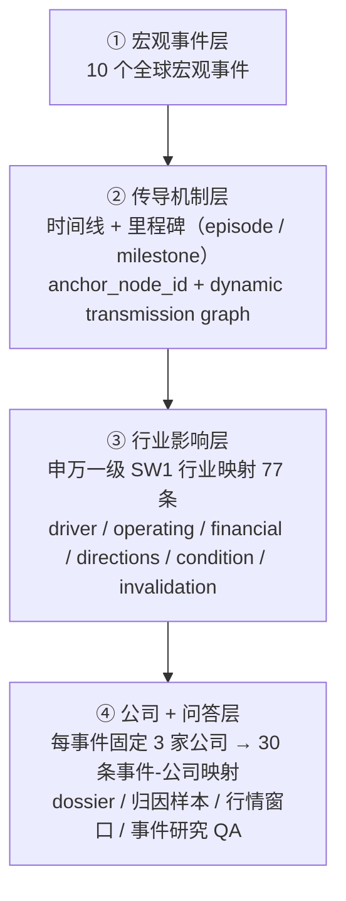

# FinGoose · 金融宏观事件传导链高质量数据集

> **一句话定位**：FinGoose 是一个**金融宏观事件驱动的、可审计、可复现的多任务高质量数据集与 SFT 训练框架**——围绕"宏观事件 → 传导机制（时间线）→ 行业影响 → 公司影响 / 事件研究问答"四层主线，把"证据 / 来源 / 时点 / 因果口径"全部结构化落盘，**答不出出处的样本一律 ABSTAIN，绝不编造因果**。

与"用大模型直接生成财经问答"的本质区别：

| 维度 | 普通 LLM 生成数据 | 本项目 |
|---|---|---|
| 数字 / 来源 | 模型"记得"、可能编造 | 每条结论挂 `source_ref` + 快照 SHA-256 + 原文定位符 |
| 因果归因 | 顺口就给因果 | 四级因果识别，非 `IDENTIFIED` **必须 ABSTAIN** |
| 事后诸葛 | 隐含未来信息 | 预测截止 = 事件后第 3 个可交易日；D20 结果进 hidden 层，公开仅见 D1/D3 |
| 缺失值 | 补 0 / 猜一个 | `KEEP_NULL_NEVER_ZERO_IMPUTE`、`KEEP_PENDING_NEVER_INFER_AVAILABLE`（fail-closed） |
| 数据契约 | 靠约定 | **21 个 JSON Schema** 硬约束 + 16 项验证门禁 |
| 交付质量 | 人肉抽查 | `VERIFY_HANDOFF.ps1` 遍历 **201 个文件**逐一 SHA-256 核验，输出 `HANDOFF VERIFIED` |

---

## 项目亮点

- **四层传导链 + 四类任务**：10 个全球宏观事件 → 时间线 / 传导机制 → 77 条申万一级（SW1）行业映射 → 30 条事件-公司映射，统一为 **157 条 SFT 样本**（`EVENT_ANALYSIS 10 / INDUSTRY_IMPACT 77 / COMPANY_IMPACT 30 / EVENT_QA 40`）。
- **Schema 驱动 + fail-closed**：先定义**21 个 JSON Schema**数据契约，再由 100+ 构建器逐层"填"、校验器逐层"守"；非合规样本不降级、不补值，直接 ABSTAIN。157 条样本全部 `CLOSED`，`missing_node=0`、`open_closure=0`、`placeholder=0`（**三个零**）。
- **抗 look-ahead 的物理隔离**：`data_cutoff.visible_windows` 硬编码 `const ["D1","D3"]`、`hidden_outcome_window` 硬编码 `const "D20"`；预测截止日 = 事件后第 3 个可交易日。
- **事件级切分防泄漏**：按 `sha256_mod_100` 分桶切分（train=event-01~08 / validation=event-09 / test=event-10），**124 / 16 / 17**，避免同一事件的样本跨集泄漏导致指标虚高。
- **可审计、可复现**：每条结论可回溯到原文定位符（如 `locator="page=1, HIGHLIGHTS, bullet 1"`）+ 快照 SHA；`SNAPSHOT_PATH_MAP.csv`（47 行）全部 `HASH_MATCHED`；同输入重建 → 相同 SHA-256。
- **诚实的质量观**：市场归因 v1 中 `UNSUPPORTED=18/40`（45%）、公司因果识别 `NOT_IDENTIFIED=30`——**承认"没有可支撑因果"恰恰是数据集的价值**，而不是缺陷。
- **工程门禁齐全**：`validate_dataset.py` 输出 `0 errors / 0 warnings`；`pytest training/tests` → **46 passed**；发布门禁 11 条 + 因果门禁 8 项 + 四角色人工审查制度。
- **交付瘦身**：交付包由 **12.1GB / 6701 文件**精简为约 **503MB / 1489 文件**，受控面 **201 个文件**逐一 SHA-256 进入 `FILE_MANIFEST.csv`。

---

## 在线查看

- **代码仓库**：https://github.com/102722jl-hash/fingoose-macro-event-dataset
- **在线站点（GitHub Pages）**：https://102722jl-hash.github.io/fingoose-macro-event-dataset/
- **交互式 UI（公司影响候选工作台）**：
  https://102722jl-hash.github.io/fingoose-macro-event-dataset/FinGoose_%E6%9C%80%E7%BB%88%E6%88%90%E6%9E%9C/01_%E4%BA%A4%E4%BB%98%E5%8C%85/FinGoose_macro_event_company_candidate_handoff_2026-07-29/work/company_impact_high_quality_v2_candidate/ui/index.html
- **项目完全剖析（HTML）**：
  https://102722jl-hash.github.io/fingoose-macro-event-dataset/FinGoose_%E9%A1%B9%E7%9B%AE%E5%AE%8C%E5%85%A8%E5%89%96%E6%9E%90.html

---

## 技术栈与运行环境

| 层 | 技术 | 备注 |
|---|---|---|
| 数据工程 / 后端 | **Python**（stdlib + dataclasses + hashlib） | 120+ 个 `.py`，约 34,449 行，`code/` 与 `training/` 为主 |
| 前端 | 原生 **HTML / CSS / JavaScript**（非框架 SPA） | 单页 Dashboard，含不可变版本链 |
| 抓取脚本 | **Node.js `.mjs`** | 如 `fetch_cninfo_company_reports_v2.mjs` |
| 启动 / 校验 | **PowerShell** | `START_UI.ps1` / `START_UI_V2.ps1` / `VERIFY_HANDOFF.ps1` |
| 数据格式 | **JSONL / JSON / CSV**（+ PDF / HTML 快照） | 无数据库，纯文件系统 |
| 训练栈 | `torch>=2.4,<3`、`transformers>=4.48,<6`、`datasets>=3,<5`、`trl>=0.15,<1`、`peft>=0.14,<1`、`accelerate>=1,<2`、`bitsandbytes>=0.45,<1`、`pytest>=7,<9` | 见 `training/requirements.txt` |
| UI 验收 | **Playwright**（系统 Chrome，双视口 1440×1000 / 390×844） | 桌面 + 移动端截图验收 |

**硬件基线**：Windows 11 / Ryzen 9 7940H / 16GB RAM / **RTX 4060 Laptop 8GB**；默认 **1.5B–3B 4-bit QLoRA**（序列长度 2048、batch 1、grad_accum 16），7B 仅作实验配置。项目刻意选择"本地 8GB 显存可跑"的档位，把交付重心放在**数据集本身的质量与可审计性**上。

**运行方式**：`START_UI.ps1`（默认端口 **8778**）调用 deep dashboard；`START_UI_V2.ps1`（默认端口 **8782**）调用 v2 dashboard；局域网查看可用 `python -m http.server 8000 --bind 0.0.0.0`。

---

## 架构总览：四层传导链与"研究区段"

### 四层传导链



- **① 宏观事件层**：10 个全球宏观事件（WHO 疫情定性 / 俄乌冲突 / 美联储加息 / 中国防疫转向 / 硅谷银行 / OPEC+ 减产 / 红海危机 / 日本结束负利率 / 中国一揽子金融政策 / 美国对等关税）。
- **② 传导机制层**：时间线 + 里程碑（`episode` / `milestone`，事件级 21 条），含事件锚点 `anchor_node_id` 与动态传导图。
- **③ 行业影响层**：申万一级（SW1）行业映射 77 条；每行业含 `driver` / `operating` / `financial` / `directions` / `condition` / `invalidation`，事件级含 `behavior_change_zh` / `counterevidence_zh`。
- **④ 公司 + 问答层**：每事件固定 3 家公司 → 30 条事件-公司映射；公司档案 dossier / 归因样本 / 行情窗口 / 事件研究 QA。

### 主 UI "研究区段"（6 段）

主 UI 将研究过程拆成 6 段线性叙事：**事件概览 → 研究问答 → 事件时间线 → 动态传导链 → 行业影响 → 公司影响**。

> 这套区段顺序**就是数据集的任务类型顺序**（EVENT_ANALYSIS → EVENT_QA → INDUSTRY_IMPACT → COMPANY_IMPACT）——前端即数据集的"可视化说明书"。

### 数据流向

宏观事件配置 → 四层构建器（`build_*`）逐层产出候选 → Schema 校验 + 门禁 → 人工审查 → 发布（`formal_ready` / `candidate_ready`）→ SFT 投影（`sft_projector`）→ 统一多任务数据集 → QLoRA 训练。

---

## 目录结构

交付包 `FinGoose_macro_event_company_candidate_handoff_2026-07-29/`（精简示意，归档目录已略）：

```
├── code/                      # 130 文件：四层构建器 + dashboard
├── training/                  # 185 文件：统一多任务 SFT 训练区（fingoose_training 包 + scripts + tests）
├── skills/                    #  23 文件：Skill 封装（SKILL.md + references + scripts + tests）
├── data/                      #  74 文件：6 个数据集版本目录
├── docs/                      #  72 文件：specs / plans / guides
├── schemas/                   #  21 文件：21 个 JSON Schema（数据契约核心）
├── configs/                   #  27 文件：事件 / 行业 / 公司 / 问答配置
├── tests/                     # 109 文件：顶层测试（对应 46 passed 验收口径）
├── evidence_snapshots/        #  40 文件（29.5MB）：证据原始快照
├── restricted/                #   2 文件：受限数据清单 / 声明
├── ui/                        #   5 文件：截图
├── work/                      # 790 文件（423.6MB）：各阶段候选工作产物（含主 UI）
├── FILE_MANIFEST.csv          # 201 个受控文件逐一 sha256
├── VERIFY_HANDOFF.ps1         # 一键核验（遍历 manifest 校验 hash + 断言关键计数）
├── START_UI.ps1 / START_UI_V2.ps1
└── HANDOFF_CURRENT_2026-08-06.md / README_HANDOFF.md / README_V2.md / NEXT_STEPS.md
```

- `schemas/` 21 个 JSON Schema，`configs/` 27 个，`tests/` 109 文件。
- 申报口径：**120 个 `.py` / 约 34,449 行**、10 个前端文件 / 约 3,558 行；前端最大单文件约 1309 行。
- 主 UI 含**不可变版本链**：`versions/fingoose-ui-20260813-r000/`、`r001/`（各含 `index.html` + `release_manifest.json` + `ui_data_bundle.js`）。

---

## 领域模型与数据规模

### 宏观事件（10 个）

`configs/fingoose_macro_events_v1.json`（63,371B）定义 10 个事件；目标资产序列覆盖 `SP500 / VIXCLS / DCOILWTICO / DCOILBRENTEU / DEXCHUS / DGS10 / DTWEXBGS / DEXJPUS`（股指、波动率、油价、汇率、美债收益率、美元指数）。

### 行业（77 条申万映射）

- 行业基线映射：`event-01` 8 条 + `event-02~10` 69 条 = **77 条**（`multi_event_closure_contract.json`：`expected_union_mapping_count=77`、`expected_mapping_count=69`）。
- 每行业字段含 `sw1_id`、`name`、`name_at_event`（**事件日的历史名称**，如 801020"采掘"）、`tier`（如 `CORE_DIRECT`）、`segments`、`driver`、`operating`、`financial`、`directions`（`POSITIVE/NEGATIVE/MIXED`）、`condition`、`invalidation`。
- 用"事件日历史行业名称"而非今日名称（`name_at_event`），避免时代错位造成的后视偏差。

### 公司（23 家 / 30 条映射）

- **每个事件固定 3 家公司** → 10 × 3 = **30 条事件-公司映射**（`configs/company_impact_high_quality_v2/event_company_map.jsonl`）。
- 公司注册表 `company_registry.jsonl` 去重后 **23 家**，当前全部 `dossier_status=DATA_PENDING`、`formal_ready=false`。
- 映射内嵌申万分类血缘：`classification_status=OFFICIAL_HISTORY_ASOF_MATCHED`、源哈希 `source_snapshot_sha256=d0f92b79…06c8843`。

### 关键数字速查

| 项目 | 数字 |
|---|---|
| 宏观事件 | 10 |
| 行业映射（申万一级） | 77 |
| 事件-公司映射 | 30 |
| 公司注册表 | 23 |
| 统一 SFT 样本 | 157（EVENT_ANALYSIS 10 / INDUSTRY_IMPACT 77 / COMPANY_IMPACT 30 / EVENT_QA 40） |
| 切分 | train 124 / val 16 / test 17 |
| 推理链 | chain 157 / evidence 4598 / node 1317 / main_path 1085 |
| 市场 v1 样本 | 40（`formal_ready=true`） |
| 公司候选样本 | 60（`candidate_ready=true`） |
| JSON Schema | 21 |
| 受控交付文件 | 201（逐一 SHA-256） |
| 测试 / 校验 | 46 passed / 0 errors · 0 warnings |

- **推理链统计**（`reasoning_chain_stats`）：`COMPANY_IMPACT 30/1119/210`、`EVENT_ANALYSIS 10/343/152`、`EVENT_QA 40/486/416`、`INDUSTRY_IMPACT 77/2650/539`，合计 chain 157 / evidence 4598 / node 1317 / main_path 1085。
- **数据清洁度三零**：`missing_node=0`、`open_closure=0`、`placeholder=0`；`content_quality_stats` 中 `complete_horizon / content_contract / review_boundary / ui_parity_pass` 均为 157。

---

## 防泄漏与可审计体系（核心）

这是本项目的第一加分项。

- **预测截止日（prediction cutoff）**：公司预测截止 = **事件后第 3 个可交易日结束时点**；QA 层 `prediction_cutoff_policy = PRIMARY_ANCHOR_PUBLICATION_PLUS_72H_DATE_VALUES_USE_END_OF_DAY_UPPER_BOUND`，逐事件给出 `prediction_cutoff_at`。
- **可见 / 隐藏窗口的 Schema 硬隔离**：`data_cutoff.visible_windows` **const `["D1","D3"]`**；`hidden_outcome_window` **const `"D20"`**（`fingoose_macro_attribution_sample_v1.schema.json`）。D20 结果与归因标签进 hidden 层（v1 市场集 `hidden_attribution_label_count=40`、`hidden_outcome_count=40`）。
- **audit_only / 评测隔离**：`answer_evaluation.distill.jsonl` 标记 `QA_EVALUATION_ONLY`、`included_in_handoff=false`；v2 候选集 `hidden_evaluation_event_count=3`、`hidden_label_count=10`；发布门禁**明确拒绝**含 hidden / evaluator_only / benchmark_labels 的样本进入训练集。
- **双时钟时间政策（temporal policy）**：三种时间角色 `AS_OF_EVIDENCE / POST_EVENT_VALIDATION / CUTOFF_BLOCKED`，字段级落地 `published_at / anchor_at / declared_role / temporal_role`。**只有 `AS_OF_EVIDENCE` 的证据才能支持预测**，`POST_EVENT_VALIDATION` 只能事后核验。
- **事件级切分（防事件级泄漏）**：`split_policy = sha256_mod_100`（桶 0–79 → train、80–89 → validation、90–99 → test），固化 **train=event-01~08 / validation=event-09 / test=event-10**。
- **缺失值 fail-closed**：`missing_evidence_policy = KEEP_PENDING_NEVER_INFER_AVAILABLE`、`missing_market_policy = KEEP_NULL_NEVER_ZERO_IMPUTE`——缺失就是缺失，绝不补 0、绝不"推断为可用"。
- **可审计 / 可复现**：`evidence_snapshots/SNAPSHOT_PATH_MAP.csv`（47 行，全部 `HASH_MATCHED`）记录 `原始路径 → 包内路径 → content_sha256`；每条结论含 `source_ref` + 原文定位符 + 快照 SHA；确定性重建同输入 → 相同 SHA-256。
- **`CUTOFF_BLOCKED` 不删节点**：一旦某节点依赖的信息晚于预测截止日，显式标记为被阻断，**保留在链中但不参与结论**——比"直接删节点"更可审计。

---

## 工程门禁与质量保证

- **校验与测试**：`validate_dataset.py` → `validation passed: 0 errors, 0 warnings`；`pytest training/tests` → **46 passed**；另有 `compileall` 语法检查、`train_sft.py --dry-run` → `ready=true`。（现存正式口径为 **46 passed**。）
- **哈希门禁**：`VERIFY_HANDOFF.ps1` 遍历 `FILE_MANIFEST.csv` 逐文件校验 SHA-256，并断言关键计数（market `event_count=10 & sample_count=40`；company `company_dossier_count=30 & candidate_sample_count=60` 等），全部通过才输出 `HANDOFF VERIFIED`。
- **发布门禁（11 条，摘录）**：`WEAK_RELATION + UNSUPPORTED >= 20%` 拒绝发布；任一标签占比 ≤ 60%；公开投影不得含隐藏标签 / D20；`formal_ready=true` 方可发布；`messages` 三条总字符数 ≤ 2000。
- **因果门禁**：因果识别四级 `IDENTIFIED / NOT_IDENTIFIED / DESCRIPTIVE_EVENT_STUDY / QUASI_EXPERIMENTAL_CANDIDATE`，**非 `IDENTIFIED` 必须 ABSTAIN**；`IDENTIFIED` 需 **8 项门禁全过**（含 `pretrend_passed`、`robustness_passed`、`counterevidence_passed`）。来源分级 T1/T2/T3/T4，**仅 T1/T2 可支持 `SOURCE_FACT`**。
- **strict-claim-closure-v2**：每行业七步节点须声明 `DIRECT_FACT / PREMISE_SUPPORT / CALCULATED_LINEAGE / NEGATIVE_SEARCH_AUDIT`；每公司至少两份事件日前证据；批量发布若事件集不全则报 `ATOMIC_BATCH_EVENT_SET_INCOMPLETE`。
- **人工审查制度**：四核心维度（归因标签合理性 / 置信度 / 竞争解释强弱 / 证据边界）；自动触发复审四条件（`LOW_CONFIDENCE`、`STRONG_COMPETING_EXPLANATION`、`CORE_DIMENSION_UNKNOWN`、`CORE_DIMENSION_CONTRADICTED`）；四角色分工（初审人 / 复审人 / 仲裁人 / 发布负责人）。

---

## 已知局限与后续规划

### 已知局限（诚实声明）

1. **商品集 v0.2 `status=blocked`**：四商品（CU/AU/SC/I）未全部完成，I（DCE 铁矿）`contract_record_count=0`；`license_scope=unknown`、`forecast_labels_generated=false`。
2. **公司因果识别全部 `NOT_IDENTIFIED`**（30 条）→ 公司结论必须 ABSTAIN；公司候选集 `formal_ready=false`，4 阻断项未清零。
3. **传导边为 AI 生成 `PROPOSED`**，未人工确认；v2 `aggregate_score=null`（不生成综合总分）。
4. **行业市场数据缺口**：申万指数历史 / 沪深300 历史在许可库中不可用（`SHENWAN_INDEX_HISTORY_NOT_AVAILABLE` 等），`gap_status=OPEN`。
5. **训练未真正执行**：未跑真实 QLoRA GPU 训练，`--dry-run` 仅 `ready=true`、`model_loaded=false`。
6. **部分来源抓取失败**：保留 `FETCH_FAILED` 状态（**拒绝用搜索摘要冒充实证**）；全部映射 / 行业 / 公司记录 `review_status=NEEDS_HUMAN_REVIEW`。

### 后续规划（`NEXT_STEPS.md`）

- 商品传导增强——优先品种 `EG/EB/L/PP/PG/I/J/JM`，范围"事件前 60 → 后 20 交易日"。
- 补齐公司官方档案，清零 `TWENTY_SEVEN_COMPANIES_REQUIRE_OFFICIAL_ARCHIVES` 等阻断项。
- 完成行业市场数据缺口（申万 / CSI300 历史），打通价格验证链。
- 真跑统一多任务 QLoRA 训练并产出 adapter。

---

## 许可 / 数据来源

数据来源与许可：见交付包内说明文件（`restricted/RESTRICTED_DATA_MANIFEST.csv` 等）。作者：102722jl-hash。
